# Realistic Superheros

Realistic Superheros is a Fabric mod for Minecraft 26.3 that adds craftable superhero armor, tools, weapons, and survival powers. The items are designed for progression in a normal survival world: early powers use familiar resources, while the strongest equipment requires Nether, End, or late-game materials.

## Features

- Five color-coded speed chestplates with continuous particle trails.
- A flight helmet for survival flight.
- Strength leggings, jump boots, and a powerful master sword.
- Fifteen additional specialized armor pieces, tools, and weapons.
- Crafting recipes for every item.
- Accurate hover tooltips describing each item's power.
- Distinct inventory preview textures for every item.
- Minecraft 26.3 and Java 25 support.

## Items And Abilities

### Velocity Chestplates

Each chestplate grants its listed Speed effect while equipped in the chest slot and continuously emits a matching colored particle trail with a white border.

| Item | Ability |
| --- | --- |
| Velocity Chestplate I | Speed I and blue trail |
| Velocity Chestplate II | Speed II and yellow trail |
| Velocity Chestplate III | Speed III and green trail |
| Velocity Chestplate IV | Speed IV and orange trail |
| Velocity Chestplate V | Speed V and red trail |

### Superhero Armor

| Item | Required slot | Ability |
| --- | --- | --- |
| Aerial Flight Helmet | Head | Survival flight while equipped |
| Titan Strength Leggings | Legs | Strength III |
| Meteor Jump Boots | Feet | Jump Boost IV and Slow Falling |
| Solar Vision Visor | Head | Night Vision |
| Deep Sea Mask | Head | Water Breathing and Dolphin's Grace |
| Flameguard Chestplate | Chest | Fire Resistance |
| Shadow Cloak | Chest | Invisibility |
| Guardian Greaves | Legs | Resistance II |
| Skywalker Boots | Feet | Speed II and Jump Boost II |
| Aquatic Fins | Feet | Water Breathing and Dolphin's Grace |
| Frostfall Cape | Chest | Slow Falling and Resistance I |

Abilities are removed when the relevant armor is unequipped. The flight helmet only grants flight to survival players; creative and spectator abilities are left unchanged.

### Powered Tools And Weapons

| Item | How to activate | Ability |
| --- | --- | --- |
| Absolute Power Sword | Hold in either hand | Invulnerability, Strength V, Resistance V, Regeneration II, and Absorption V |
| Kinetic Bracers | Hold in either hand | Haste III |
| Thunder Hammer | Hold in either hand | Strength IV and Resistance II |
| Life Staff | Hold in either hand | Regeneration III and Absorption III |
| Gravity Pickaxe | Hold in either hand | Haste IV |
| Builder Gauntlet | Hold in either hand | Haste II and Speed I |
| Timekeeper Watch | Hold in either hand | Night Vision and Slow Falling |
| Phase Compass | Hold in either hand | Invisibility and Speed I |

The Absolute Power Sword is intentionally an endgame, overpowered item. Its invulnerability is reversible: putting it away removes the survival invulnerability state.

### Visual Item Reference

The following atlas shows the generated inventory previews for the mod's items. Each preview now uses a recognizable silhouette for the item rather than a generic square.

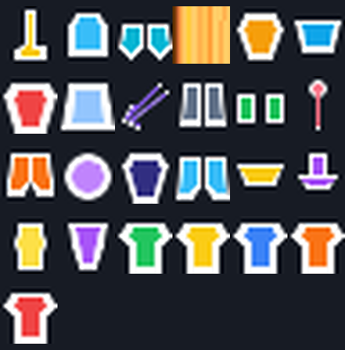

## Crafting Recipes

All recipes are shaped crafting recipes. A space in a pattern represents an empty slot. Items are shown by their ingredient key.

The ingredient atlas below contains the actual Minecraft 26.3 item textures used by the recipes. Use it alongside the patterns and ingredient tables when identifying materials.


These vanilla ingredient images were extracted from the Minecraft 26.3 client assets resolved for this project. Minecraft asset ownership remains with Mojang/Microsoft; those images are documentation references and are not covered by this project's MIT license.

### Visual Recipe Cards

These cards use the same 3x3 grid and output-slot layout as the Minecraft crafting interface. Every card is generated from the corresponding recipe pattern and includes the real ingredient and output icons.

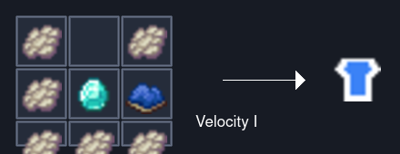

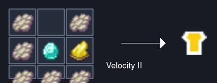

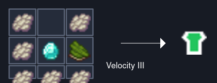

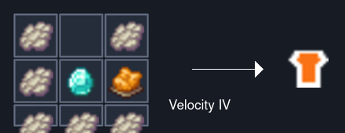

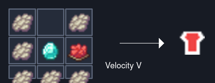

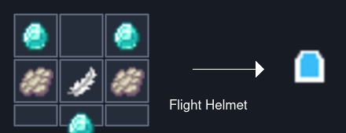

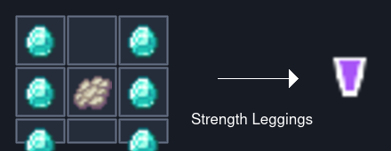

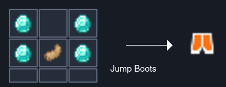

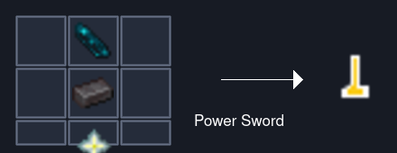

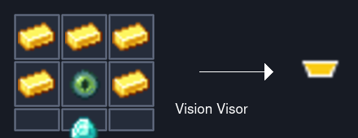

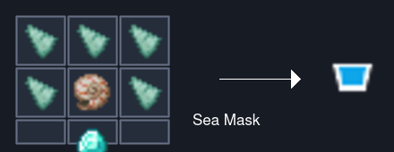

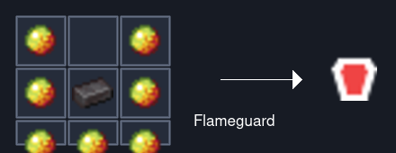

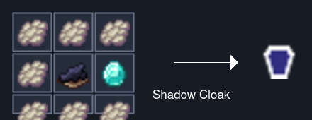

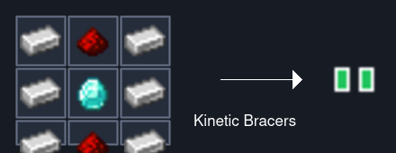

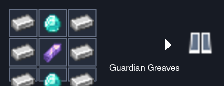

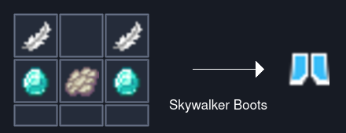

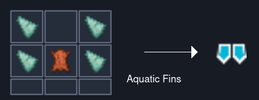

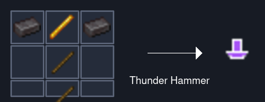

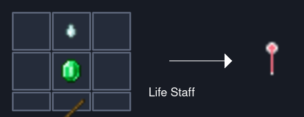

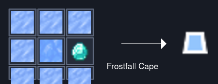

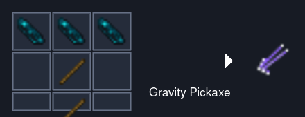

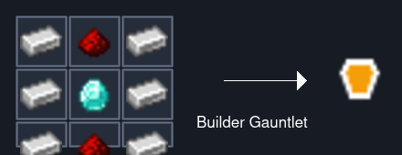

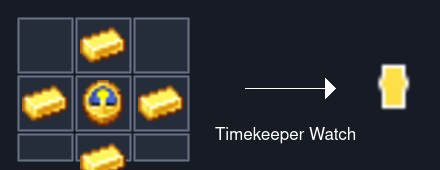

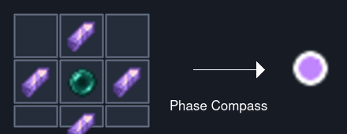

The cards can be regenerated from the current resource set with `tools/generate_recipe_cards.sh`.

### Velocity Chestplates

Pattern for every color:

```text
P P
PDC
PPP
```

| Key | Ingredient |
| --- | --- |
| `P` | Phantom Membrane |
| `D` | Diamond |
| `C` | Matching dye: blue, yellow, green, orange, or red |

The matching dye produces the corresponding Velocity Chestplate tier. The dye does not determine the speed tier; the color does.

### Core Armor

#### Aerial Flight Helmet

```text
D D
PFP
 D 
```

`D` is Diamond, `P` is Phantom Membrane, and `F` is Feather.

#### Titan Strength Leggings

```text
D D
DPD
D D
```

`D` is Diamond and `P` is Phantom Membrane.

#### Meteor Jump Boots

```text
D D
DPD
```

`D` is Diamond and `P` is Rabbit's Foot.

### Specialized Armor

#### Solar Vision Visor

```text
GGG
GEG
 D 
```

`G` is Gold Ingot, `E` is Ender Eye, and `D` is Diamond.

#### Deep Sea Mask

```text
PPP
PNP
 D 
```

`P` is Prismarine Shard, `N` is Nautilus Shell, and `D` is Diamond.

#### Flameguard Chestplate

```text
M M
MNM
MMM
```

`M` is Magma Cream and `N` is Netherite Ingot.

#### Shadow Cloak

```text
PPP
PBD
PPP
```

`P` is Phantom Membrane, `B` is Black Dye, and `D` is Diamond.

#### Guardian Greaves

```text
IDI
IAI
IDI
```

`I` is Iron Ingot, `A` is Amethyst Shard, and `D` is Diamond.

#### Skywalker Boots

```text
F F
DPD
```

`F` is Feather, `D` is Diamond, and `P` is Phantom Membrane.

#### Aquatic Fins

```text
P P
PLP
```

`P` is Prismarine Shard and `L` is Leather.

#### Frostfall Cape

```text
PPP
PBD
PPP
```

`P` is Packed Ice, `B` is Blue Ice, and `D` is Diamond.

### Powered Weapons And Tools

#### Absolute Power Sword

```text
 E 
 N 
 S 
```

`E` is Echo Shard, `N` is Netherite Ingot, and `S` is Nether Star.

#### Kinetic Bracers

```text
IRI
IDI
IRI
```

`I` is Iron Ingot, `R` is Redstone, and `D` is Diamond.

#### Thunder Hammer

```text
NBN
 S 
 S 
```

`N` is Netherite Ingot, `B` is Blaze Rod, and `S` is Stick.

#### Life Staff

```text
 G 
 E 
 S 
```

`G` is Ghast Tear, `E` is Emerald, and `S` is Stick.

#### Gravity Pickaxe

```text
EEE
 S 
 S 
```

`E` is Echo Shard and `S` is Stick.

#### Builder Gauntlet

```text
IRI
IDI
IRI
```

`I` is Iron Ingot, `R` is Redstone, and `D` is Diamond.

#### Timekeeper Watch

```text
 G 
GEG
 G 
```

`G` is Gold Ingot and `E` is Clock.

#### Phase Compass

```text
 A 
APA
 A 
```

`A` is Amethyst Shard and `P` is Ender Pearl.

## Getting Started In Survival

1. Begin with a Velocity Chestplate using Phantom Membranes, a Diamond, and a dye.
2. Upgrade mobility with the Meteor Jump Boots or Aerial Flight Helmet.
3. Explore oceans for the Deep Sea Mask and Aquatic Fins.
4. Explore the Nether for Flameguard Chestplate, Thunder Hammer, and the Absolute Power Sword materials.
5. Explore Ancient Cities and the End for Echo Shards, Amethyst, Ender Pearls, and Nether Stars.
6. Use the Combat creative tab to inspect all item names and hover descriptions in a test world.

## Development Setup

This project targets Minecraft 26.3, Fabric Loader 0.20.1, Fabric API 0.164.0+26.3, and Java 25.

### Required Fabric API

The game instance must include the **Fabric API** mod built for Minecraft 26.3. The tested version is `fabric-api-0.164.0+26.3.jar`. Download Fabric API from its official Fabric project page on [Modrinth](https://modrinth.com/mod/fabric-api), or use the official [Fabric Maven repository](https://maven.fabricmc.net/net/fabricmc/fabric-api/fabric-api/). Choose the newest Fabric API release whose version suffix is `+26.3` if `0.164.0+26.3` is no longer the newest available release.

Install Fabric API into the same Minecraft 26.3 instance as this mod. Fabric Loader alone is not sufficient because the item-group, particle, lifecycle, and other APIs used by Realistic Superheros are supplied by Fabric API.

### Standard Java Environment

Set `JAVA_HOME` to a Java 25 JDK, then run:

```bash
./gradlew clean build
./gradlew runClient
```

### VS Code Flatpak

The VS Code Flatpak can access the host JDK through `flatpak-spawn`:

```bash
flatpak-spawn --host bash -lc '\
export JAVA_HOME=/usr/lib/jvm/java-25-openjdk && \
export PATH="$JAVA_HOME/bin:$PATH" && \
./gradlew clean build'
```

The built mod jar is written to `build/libs/`.

## Project Layout

- `src/main/java`: shared item behavior and registration.
- `src/client/java`: client-only initialization.
- `src/main/resources/assets`: item definitions, models, textures, language names, and particles.
- `src/main/resources/data`: survival crafting recipes.
- `build/libs`: generated distributable jars.

## License

This project is open source under the MIT License. Copyright (c) 2026 WittyWilla (@wittywilla). See [LICENSE](LICENSE) for the full terms.
